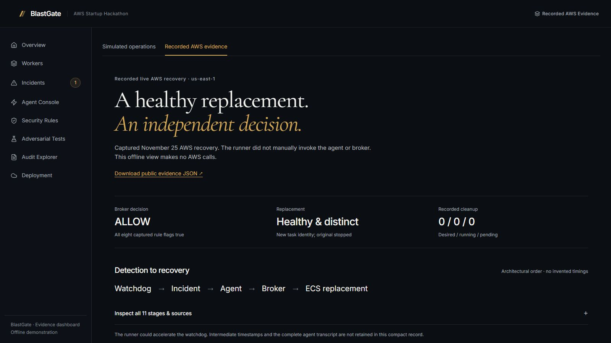
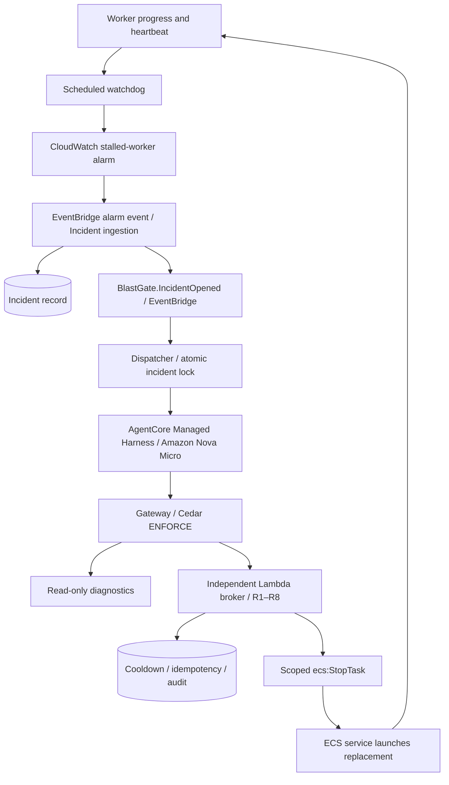

# BlastGate

**Autonomous Recovery. Provable Boundaries.**

BlastGate detects an application-stalled ECS worker, asks Amazon Nova Micro through Bedrock AgentCore to investigate, and permits one bounded recovery action only after an independent Lambda broker validates operational rules R1–R8.

An ECS task can remain `RUNNING` while its processing loop has stopped making progress. Restarting everything is risky; letting a model decide its own permissions is riskier. BlastGate separates diagnosis, proposal, authorization, execution, and verification. The model never holds `ecs:StopTask` authority.

## Watch the 2-Minute Demo

<p align="center">
  <a href="https://mdzubair933.github.io/blastgate-autonomous-recovery/">
    
  </a>
  <br>
  <a href="https://mdzubair933.github.io/blastgate-autonomous-recovery/"><strong>▶ Open the full-size, centered video player</strong></a>
</p>

*120-second narrated technical walkthrough with burned subtitles. The demonstration uses historical recorded AWS evidence, architecture animation, and offline dashboard views; it does not show live AWS telemetry.*

## Recorded result

The November 25, 2026 unattended run recorded an incident, dispatcher session, broker `ALLOW`, all eight rule flags, the original task stopped, and a distinct replacement publishing healthy telemetry. Cleanup was recorded at **13:36:50 UTC** with **0 desired / 0 running / 0 pending** tasks. This is historical evidence, not current AWS state.

The runner does not manually invoke the harness or broker. It **can invoke the watchdog** to accelerate detection. Intermediate stage timestamps and a full model/tool transcript are absent from the compact run JSON. The external Antigravity report contains additional claims; this public presentation uses the available captured evidence and inspected source.

- [Public recorded evidence](evidence/public/recorded-evidence.json)
- [Evidence scope and redactions](docs/EVIDENCE.md)
- [Architecture and trust boundaries](docs/ARCHITECTURE.md)
- [Setup, tests, deployment and cleanup](docs/REPRODUCTION.md)
- [Demo walkthrough](docs/DEMO.md)
- [Security and limitations](docs/SECURITY.md)
- [Engineering challenges](docs/ENGINEERING.md)
- [Final validation and release report](docs/FINALIZATION_REPORT.md)
- [UI refinement and screenshot guide](docs/UI_REFINEMENT_CHANGELOG.md)
- [Final screenshot gallery](docs/submission/GALLERY.md)
- [Stage 2 media readiness and video](docs/submission/MEDIA_READINESS_REPORT.md)
- [Official submission readiness and verified evidence](docs/submission/READINESS_REPORT.md)

## Video materials

- **Full-size player:** [Open the centered demo player](https://mdzubair933.github.io/blastgate-autonomous-recovery/)
- **Video frames contact sheet:** [docs/submission/assets/final/video-frames/contact-sheet.png](docs/submission/assets/final/video-frames/contact-sheet.png)
- **Storyboard and narration script:** [docs/submission/video/STORYBOARD.md](docs/submission/video/STORYBOARD.md)
- **Visual gallery & frame contacts:** [docs/submission/GALLERY.md](docs/submission/GALLERY.md)
- **Editable video source and local export:** [video project](docs/submission/video/README.md); the original export is preserved locally in `media-exports/blastgate-demo-120s.mp4` and `release/blastgate-stage2-media.zip`.



*Genuine local-dashboard capture. Recorded observations are historical; this is not an AWS Console screenshot or live telemetry.*

## Architecture



Guardrails and the system prompt constrain model behavior. Cedar restricts caller and tool access. The broker independently evaluates live inventory, application telemetry, capacity, cooldown and catalog scope. IAM limits the available mutation. See [architecture](docs/ARCHITECTURE.md) for source links and the evidence boundary.

## R1–R8

| Rule | Required boundary |
|---|---|
| R1 | One catalog action; exact sandbox cluster, service membership and task family. |
| R2 | Projected healthy capacity ≥4 and projected unavailable capacity ≤20%, including missing workers and unhealthy/unknown siblings. |
| R3 | Fresh trusted application telemetry confirms the target is unhealthy; stale evidence is refused. |
| R4 | One cluster-wide remediation reservation per 600 seconds; no model override. |
| R5 | Versioned action/runbook ID and schema binding; log or runbook prose cannot grant permissions. |
| R6 | Structured audit before mutation; post-execution persistence failures remain visible without denying an actual mutation. |
| R7 | Agent proposes; only the separately scoped broker executes the approved task stop. |
| R8 | Atomic reservations, durable idempotency and fail-closed handling under uncertainty. |

The existing [operational contract](contracts/OPERATIONAL_RULES.md) and [threat model](contracts/threat_model.md) remain the detailed specifications. No rule or backend was changed during frontend finalization.

## Run the dashboard locally

Prerequisites: Node.js 24 (or 22.12+) and npm. From PowerShell:

```powershell
cd dashboard
npm ci
npm run dev -- --hostname 127.0.0.1
```

Open [the local dashboard](http://127.0.0.1:3000). Choose **Simulated operations** for interactive fixtures or **Recorded AWS evidence** for captured results. All eight operational sections are available through the sidebar. No AWS credentials are required or consumed by the dashboard.

```powershell
npm test
npm run build
npm start -- --hostname 127.0.0.1
```

The application uses the Next.js server build, not a configured static export. The live-data provider remains deliberately disconnected.

## Verification and release status

Historical reports document Step 6 live recovery, eight mixed-layer Step 7 adversarial checks, post-hardening direct-service verification, and the later unattended run. Live adversarial evaluations include 8 recorded Bedrock AgentCore Managed Harness executions: 5 reached model inference (1 complete natural-language refusal in ADV-03 plus 4 diagnostic tool queries followed by outbound Guardrail intervention) and 3 pre-inference perimeter blocks, with zero unauthorized ECS mutations. See [adversarial audit](docs/submission/ADVERSARIAL_EVIDENCE_AUDIT.md). **Scenario 4 combines a local quorum refusal with an earlier live inventory denial**; it is not a live broker quorum-branch test. A separate post-hardening run captures a live capacity denial.

Fresh local test/build results and actual browser checks are recorded in [the finalization report](docs/FINALIZATION_REPORT.md). Historical reports are preserved locally and excluded from the curated public package because they contain operational identifiers and superseded statements.

The repository is published and open source, licensed under [MIT](LICENSE). Dependencies retain their own licenses. See [release preparation](docs/RELEASE.md).
