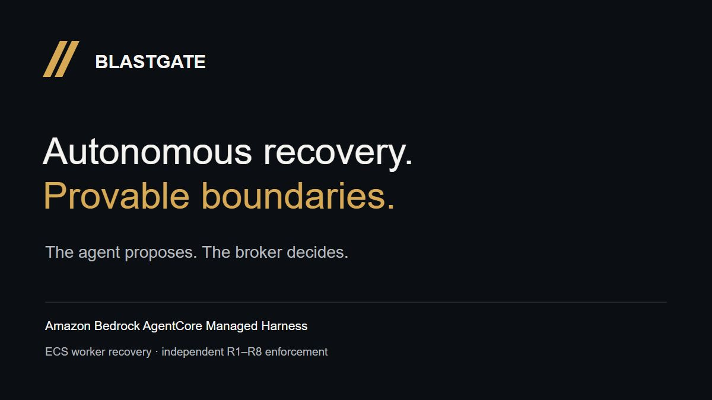
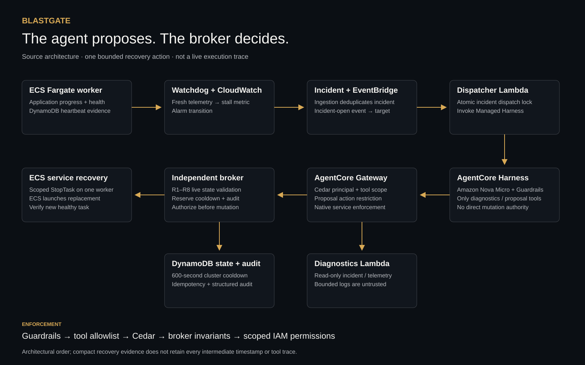

<p align="center">
  <a href="https://mdzubair933.github.io/blastgate-autonomous-recovery/">
    
  </a>
</p>

<p align="center">
  <a href="https://mdzubair933.github.io/blastgate-autonomous-recovery/"><strong>Watch the 2-minute demo</strong></a>
  &nbsp; · &nbsp;
  <a href="https://youtu.be/WtddIVtfIfk">YouTube</a>
  &nbsp; · &nbsp;
  <a href="docs/submission/GALLERY.md">Evidence gallery</a>
  &nbsp; · &nbsp;
  <a href="#run-locally">Run locally</a>
</p>

# BlastGate

An ECS worker can be `RUNNING` while its processing loop has stalled. BlastGate asks **Amazon Nova Micro through Bedrock AgentCore** to investigate, then permits one bounded recovery action only after an **independent Lambda broker** validates rules R1–R8. The model never holds `ecs:StopTask` authority.

The narrated demo combines historical AWS evidence, architecture animation and offline dashboard views. **It does not show live AWS telemetry.**

## Recovery, recorded

The **November 25, 2026** unattended run captured the recovery sequence:

| Authorization | Recovery | Cleanup |
| :--- | :--- | :--- |
| Broker `ALLOW`; all eight rule flags recorded | Original task stopped; a distinct replacement published healthy telemetry | **0 desired / 0 running / 0 pending** at 13:36:50 UTC |

[Inspect the public evidence](evidence/public/recorded-evidence.json) · [Read the evidence scope](docs/EVIDENCE.md)


*Actual local-dashboard capture of recorded AWS observations. Historical evidence; not an AWS Console screenshot or current AWS state.*

<details>
<summary><strong>What this run proves — and its limits</strong></summary>

The runner does not manually invoke the harness or broker. It **can invoke the watchdog** to accelerate detection. The compact run JSON does not retain intermediate stage timestamps or a full model/tool transcript.

This presentation relies on captured evidence and inspected source. Additional claims in the external Antigravity report are not adopted here. See [the unattended demo](docs/DEMO.md) and [security limitations](docs/SECURITY.md).

</details>

## The agent proposes. The broker decides.

[](docs/ARCHITECTURE.md)

Guardrails and the system prompt constrain model behavior. **Cedar** restricts caller and tool access. The **broker** independently checks inventory, application telemetry, capacity, cooldown and catalog scope. **IAM** limits the available mutation.

[Explore the architecture and source links](docs/ARCHITECTURE.md) · [Open the full-size diagram](docs/submission/assets/architecture.png)

## Eight operational boundaries

| Rule | Required boundary |
|---|---|
| R1 | One catalog action; exact sandbox cluster, service membership and task family. |
| R2 | Projected healthy capacity ≥4 and projected unavailable capacity ≤20%, including missing workers and unhealthy/unknown siblings. |
| R3 | Fresh trusted application telemetry confirms the target is unhealthy; stale evidence is refused. |
| R4 | One cluster-wide remediation reservation per 600 seconds; no model override. |
| R5 | Versioned action/runbook ID and schema binding; log or runbook prose cannot grant permissions. |
| R6 | Structured audit before mutation; post-execution persistence failures remain visible without denying an actual mutation. |
| R7 | Agent proposes; only the separately scoped broker executes the approved task stop. |
| R8 | Atomic reservations, durable idempotency and fail-closed handling under uncertainty. |

[Operational contract](contracts/OPERATIONAL_RULES.md) · [Threat model](contracts/threat_model.md)

## Adversarial evidence

The public audit separates **model activity, perimeter blocks and direct-service checks**.

- **8 recorded Managed Harness executions:** 5 reached model inference; 3 were blocked before inference.
- Of the 5, **4 queried diagnostics before outbound Guardrail intervention**. ADV-03 returned a missing-incident response.
- **Zero unauthorized ECS mutations** were recorded in these evaluations.

[Inspect the prompt-response records and their limits](docs/submission/ADVERSARIAL_EVIDENCE_AUDIT.md)

<details>
<summary><strong>Earlier tests and capacity-denial evidence</strong></summary>

The original eight Step 7 scenarios are mixed-layer checks, not eight agent prompt-response executions. Reports also cover Step 6 live recovery, post-hardening direct-service verification and the later unattended run.

**Scenario 4 combines a local quorum refusal with an earlier live inventory denial.** It is not a live broker quorum-branch test. A separate post-hardening run captures a live capacity denial.

See [submission readiness](docs/submission/READINESS_REPORT.md) and [the finalization report](docs/FINALIZATION_REPORT.md). Historical private reports are excluded from the curated package because they contain operational identifiers and superseded statements.

</details>

## Run locally

Requires Node.js 24 (or 22.12+) and npm. From PowerShell:

```powershell
cd dashboard
npm ci
npm run dev -- --hostname 127.0.0.1
```

Open **[localhost:3000](http://127.0.0.1:3000)** and choose a mode:

| Mode | What you see |
| :--- | :--- |
| Simulated operations | Interactive local fixtures |
| Recorded AWS evidence | Captured historical results |

All eight dashboard sections are available from the sidebar. **No AWS credentials are required or consumed.** The live-data provider is disconnected.

<details>
<summary><strong>Test and production build</strong></summary>

```powershell
npm test
npm run build
npm start -- --hostname 127.0.0.1
```

The dashboard uses the Next.js server build, not a configured static export. Existing test/build results and browser checks are documented in [the finalization report](docs/FINALIZATION_REPORT.md).

For backend setup, deployment and cleanup, follow [the reproduction guide](docs/REPRODUCTION.md).

</details>

## Explore the project

| Understand | Verify | Present |
| :--- | :--- | :--- |
| [Architecture](docs/ARCHITECTURE.md) | [Evidence and redactions](docs/EVIDENCE.md) | [Screenshot gallery](docs/submission/GALLERY.md) |
| [Security and limitations](docs/SECURITY.md) | [Adversarial audit](docs/submission/ADVERSARIAL_EVIDENCE_AUDIT.md) | [Submission readiness](docs/submission/READINESS_REPORT.md) |
| [Engineering challenges](docs/ENGINEERING.md) | [Final validation](docs/FINALIZATION_REPORT.md) | [UI and screenshot guide](docs/UI_REFINEMENT_CHANGELOG.md) |
| [Reproduction guide](docs/REPRODUCTION.md) | [Release preparation](docs/RELEASE.md) | [Media readiness](docs/submission/MEDIA_READINESS_REPORT.md) |

<details>
<summary><strong>Video source, storyboard and frames</strong></summary>

- [Storyboard and narration](docs/submission/video/STORYBOARD.md)
- [Video frames contact sheet](docs/submission/assets/final/video-frames/contact-sheet.png)
- [Editable video project](docs/submission/video/README.md)

The original export is preserved locally in `media-exports/blastgate-demo-120s.mp4` and `release/blastgate-stage2-media.zip`.

</details>

Licensed under **[MIT](LICENSE)**. Dependencies retain their own licenses.
