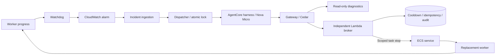

<div align="center">

# BlastGate

### Autonomous recovery. Provable boundaries.

**A stalled ECS worker should recover safely — without giving an AI the keys to production.**

[](https://mdzubair933.github.io/blastgate-autonomous-recovery/)

[▶ **Watch the demo**](https://mdzubair933.github.io/blastgate-autonomous-recovery/) · [YouTube](https://youtu.be/WtddIVtfIfk) · [Explore the architecture](#how-it-works) · [Run the dashboard](#run-the-dashboard)

</div>

> [!IMPORTANT]
> **Recorded evidence, not live telemetry.** The video and dashboard use historical, sanitized AWS observations and offline views. They do not represent current AWS state.

BlastGate detects when an ECS worker's application has stopped making progress, asks Amazon Nova Micro through Bedrock AgentCore to investigate, and allows one bounded recovery action only after an independent Lambda broker validates rules R1–R8. The model can propose a recovery; it never has `ecs:StopTask` authority.

## Why BlastGate

| Diagnose | Constrain | Authorize | Verify |
|---|---|---|---|
| Detect a stalled processing loop even when its ECS task still reports `RUNNING`. | Cedar, scoped IAM, and explicit rules keep model access bounded. | An independent broker checks live state and reserves one safe action. | The replacement worker must publish healthy telemetry; each step is audited. |

Restarting everything is risky. Letting a model choose its own permissions is riskier. BlastGate keeps diagnosis, proposal, authorization, execution, and verification separate.

## Recorded recovery

The November 25, 2026 unattended run recorded an incident, a dispatcher session, broker `ALLOW`, all eight rule flags, the original task stopping, and a distinct replacement publishing healthy telemetry. Cleanup was recorded at **13:36:50 UTC** with **0 desired / 0 running / 0 pending** tasks.

> [!NOTE]
> This is a historical run, not a claim about current AWS resources. The runner did not manually invoke the harness or broker; it could invoke the watchdog to accelerate detection. The compact run JSON does not contain intermediate stage timestamps or the complete model/tool transcript. This presentation uses captured evidence and inspected source, rather than additional claims in the external Antigravity report.

[Open the recorded evidence](evidence/public/recorded-evidence.json) · [Evidence scope and redactions](docs/EVIDENCE.md)

## Run the dashboard

Try the interactive simulated operations or browse the recorded AWS evidence. All eight operational sections are available in the sidebar. **No AWS credentials are required or consumed.** The live-data provider is deliberately disconnected.

Prerequisites: Node.js 24 (or 22.12+) and npm. From PowerShell:

```powershell
cd dashboard
npm ci
npm run dev -- --hostname 127.0.0.1
```

Open [http://127.0.0.1:3000](http://127.0.0.1:3000), then choose **Simulated operations** or **Recorded AWS evidence**.

```powershell
npm test
npm run build
npm start -- --hostname 127.0.0.1
```

The app uses the Next.js server build; it is not configured as a static export.

## How it works



Guardrails and the system prompt constrain model behavior. Cedar restricts callers and tools. The broker independently evaluates live inventory, application telemetry, capacity, cooldown, and catalog scope. IAM limits the available mutation. See [architecture and trust boundaries](docs/ARCHITECTURE.md) for source links and evidence boundaries.

## The safety contract: R1–R8

| Rule | Boundary enforced |
|---|---|
| **R1 · Scope** | One catalog action; exact sandbox cluster, service membership, and task family. |
| **R2 · Capacity** | Projected healthy capacity ≥4 and projected unavailable capacity ≤20%, including missing workers and unhealthy/unknown siblings. |
| **R3 · Evidence** | Fresh, trusted application telemetry must confirm the target is unhealthy; stale evidence is refused. |
| **R4 · Cooldown** | One cluster-wide remediation reservation per 600 seconds; no model override. |
| **R5 · Catalog** | Versioned action/runbook ID and schema binding; logs or runbook prose cannot grant permissions. |
| **R6 · Audit** | Structured audit before mutation; post-execution persistence failures remain visible without denying an actual mutation. |
| **R7 · Separation** | The agent proposes; only the separately scoped broker executes the approved task stop. |
| **R8 · Consistency** | Atomic reservations, durable idempotency, and fail-closed handling under uncertainty. |

The [operational contract](contracts/OPERATIONAL_RULES.md) and [threat model](contracts/threat_model.md) contain the detailed specifications. No rule or backend was changed during frontend finalization.

## Dashboard preview


*Genuine local-dashboard capture. The observations are historical; this is not an AWS Console screenshot or live telemetry.*

## Verification and limitations

Historical reports cover Step 6 live recovery, eight mixed-layer Step 7 adversarial checks, post-hardening direct-service verification, and the unattended run. The live adversarial evaluation recorded 8 Bedrock AgentCore Managed Harness executions: 5 reached model inference (1 complete natural-language refusal in ADV-03 and 4 diagnostic tool queries followed by outbound Guardrail intervention); 3 were blocked at the perimeter before inference. No unauthorized ECS mutations were recorded.

**Scenario 4 combines a local quorum refusal with an earlier live inventory denial**; it is not a live broker quorum-branch test. A separate post-hardening run captures a live capacity denial. Fresh local test/build results and browser checks are documented in the [finalization report](docs/FINALIZATION_REPORT.md). Historical reports containing operational identifiers or superseded statements are preserved locally and excluded from the curated public package.

<details>
<summary>Explore reports, evidence, and project materials</summary>

| Topic | Resources |
|---|---|
| **Architecture & security** | [Architecture](docs/ARCHITECTURE.md) · [Security and limitations](docs/SECURITY.md) · [Threat model](contracts/threat_model.md) |
| **Build & operate** | [Setup, tests, deployment, and cleanup](docs/REPRODUCTION.md) · [Engineering challenges](docs/ENGINEERING.md) · [Release preparation](docs/RELEASE.md) |
| **Evidence & validation** | [Recorded evidence](evidence/public/recorded-evidence.json) · [Evidence scope](docs/EVIDENCE.md) · [Final validation report](docs/FINALIZATION_REPORT.md) · [Adversarial evidence audit](docs/submission/ADVERSARIAL_EVIDENCE_AUDIT.md) |
| **Demo & visuals** | [Walkthrough](docs/DEMO.md) · [Screenshot gallery](docs/submission/GALLERY.md) · [UI refinement notes](docs/UI_REFINEMENT_CHANGELOG.md) · [Video storyboard and narration](docs/submission/video/STORYBOARD.md) · [Video frames contact sheet](docs/submission/assets/final/video-frames/contact-sheet.png) |
| **Submission** | [Media readiness and video](docs/submission/MEDIA_READINESS_REPORT.md) · [Official readiness and verified evidence](docs/submission/READINESS_REPORT.md) |

**Video:** [Full-size player](https://mdzubair933.github.io/blastgate-autonomous-recovery/) · [YouTube](https://youtu.be/WtddIVtfIfk) · [Editable project notes](docs/submission/video/README.md). The original export is preserved locally in `media-exports/blastgate-demo-120s.mp4` and `release/blastgate-stage2-media.zip`.

</details>

---

Published under the [MIT License](LICENSE). Dependencies retain their own licenses.
